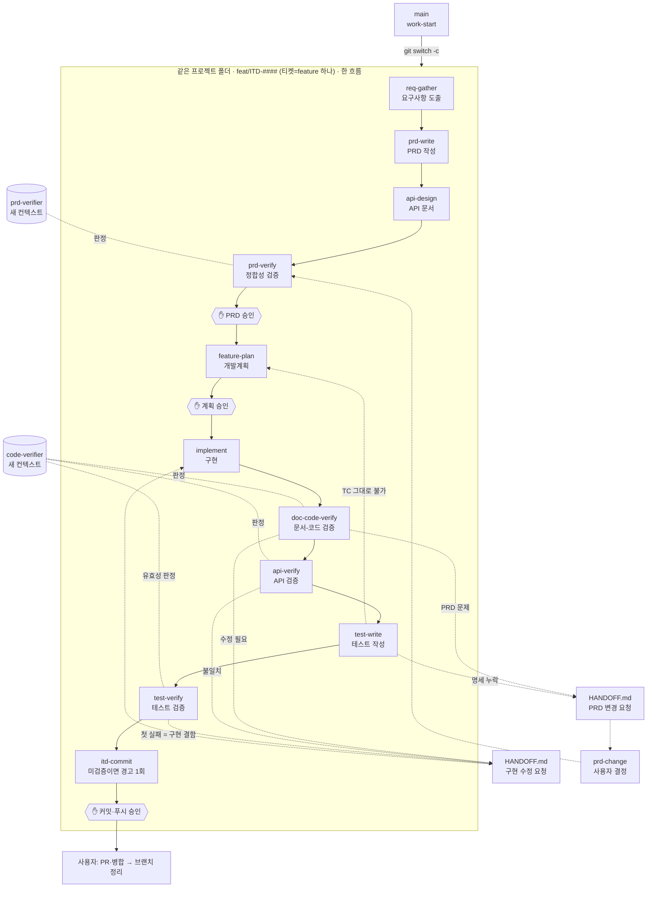

# harness-with-claude

SI 프로젝트(보통 4~5일 단위)용 **Claude 단독 하네스**입니다. 요구사항 정리부터 PRD·API 문서, 개발계획, 구현, 테스트, 검증, 커밋까지 Claude가 한 흐름으로 진행합니다. Claude 계정 두 개를 번갈아 쓰는 환경을 전제로, 한 계정의 토큰이 떨어지면 다른 계정이 같은 폴더에서 파일만 보고 이어 받습니다. 모든 결과물은 요구사항 ID로 이어져 검증됩니다.

**핵심 원칙**

- **한 흐름**: 단계마다 담당을 나누지 않습니다. 앞 단계가 끝나면 같은 세션에서 다음 단계로 넘어가고, 승인 게이트·사람이 정할 항목·PRD 변경·환경 문제에서만 멈춥니다.
- **작성자 ≠ 판정자**: 같은 세션이 만들고, 판정은 새 컨텍스트의 검증 에이전트(`prd-verifier`, `code-verifier`)가 원문만 보고 합니다. 메인 세션은 자기 결과를 "검증 완료"로 보고하지 않습니다.
- **계정이 바뀌어도 이어 감**: 맥락은 대화가 아니라 파일(`HANDOFF.md` 진행 위치, 계획, 검증 산출물, `git diff`)로 넘깁니다. 새 세션이 열리면 훅이 인계 상태를 자동으로 보여줍니다.
- **문서가 원본**: 요구사항, PRD, API 문서가 기준입니다. 코드는 문서를 따르고, 테스트 기대값도 문서에서만 가져옵니다. 구현과 테스트를 같은 흐름에서 쓰므로 테스트가 구현을 따라가면 `무효(구현 추종)`로 걸립니다.
- **사람이 승인**: 다음 단계로 넘어가는 네 지점(PRD, 계획, 커밋, 푸시)은 사용자가 승인 문구를 직접 입력해야 열립니다.
- **ID로 추적**: `REQ → PRD → API → PLAN → 테스트`가 ID로 연결되고, 누락은 스크립트가 기계적으로 찾습니다.

## 목차

1. [요구 환경](#1-요구-환경)
2. [시작하기](#2-시작하기)
3. [전체 흐름](#3-전체-흐름)
4. [단계별 절차](#4-단계별-절차)
5. [계정 전환 인계](#5-계정-전환-인계)
6. [테스트 규칙](#6-테스트-규칙)
7. [승인 게이트](#7-승인-게이트)
8. [추적과 검증](#8-추적과-검증)
9. [되돌림: 구현 수정·재계획·PRD 변경](#9-되돌림-구현-수정재계획prd-변경)
10. [예외: 하네스 도입·업데이트](#10-예외-하네스-도입업데이트)
11. [Git 규칙](#11-git-규칙)
12. [훅이 막는 것](#12-훅이-막는-것)
13. [모델 구성](#13-모델-구성)
14. [디렉터리 구조](#14-디렉터리-구조)
15. [하네스 검증](#15-하네스-검증)
16. [제약사항](#16-제약사항)
17. [문제 해결](#17-문제-해결)

---

## 1. 요구 환경

| 항목 | 내용 |
| --- | --- |
| OS | macOS, Linux, Windows (훅이 POSIX `sh`를 사용. Windows는 Git for Windows의 Git Bash) |
| 도구 | `git`, `jq`, Node.js 18 이상(`check-api.mjs`). `jq`가 없으면 훅이 모든 도구를 차단합니다 |
| Windows 설치 | `winget install Git.Git jqlang.jq OpenJS.NodeJS.LTS` 후 VS Code·터미널 재시작 |
| AI 도구 | Claude Code. 계정 두 개를 번갈아 쓰는 구성을 전제로 하지만 한 계정으로도 그대로 동작합니다 |
| 대상 스택 | Java + Spring Boot 기본. DB·메시지 큐 등은 프로젝트마다 `project-init`에서 결정 |

두 계정 모두 **같은 PC의 같은 프로젝트 폴더**에서 씁니다. 승인 기록(`.harness/state/`)은 git에 올라가지 않는 로컬 파일이고, 어느 계정의 세션이든 이 폴더의 기록을 함께 보기 때문입니다.

## 2. 시작하기

상황에 맞는 방법 하나를 고릅니다.

### 2-1. 새 프로젝트

```bash
git clone https://github.com/sju3358/harness-with-claude.git <프로젝트명>
cd <프로젝트명>
git rev-parse HEAD > .harness/version   # 설치한 하네스 버전 기록 (업데이트 기준)
rm -rf .git && git init -b main         # 하네스 이력을 끊고 프로젝트 저장소로 시작
```

Claude 세션을 열고 **"프로젝트 초기 셋팅해줘"** 라고 하면 `project-init`이 다음을 진행합니다.

1. 스택을 질문합니다. Java·Spring Boot 버전, 빌드 도구, DB, ORM, 메시지 큐, 인증, 배포 대상, 테스트 방식을 매번 묻습니다.
2. 답을 `docs/project.md`에 기록하고, 검증 명령(빌드·테스트)이 맞는지 확인받습니다.
3. Git 훅을 등록합니다(`core.hooksPath`).
4. 초기 커밋과 `main` push 명령을 안내합니다. 이 작업은 사용자가 직접 실행합니다.

이어서 같은 세션에서 **"ITD-1234 작업 시작해줘"** 라고 하면 작업 브랜치로 전환되고, 그 세션에서 바로 요구사항 정리부터 진행합니다([3장](#3-전체-흐름)).

### 2-2. 진행 중인 프로젝트에 도입

하네스가 없는 기존 프로젝트 루트에서 Claude 세션을 열고 **"이 프로젝트에 하네스 도입해줘"** 라고 합니다. `harness-adopt`가 하네스를 받아 기존 파일(`CLAUDE.md`, 설정, Git 훅)과 병합하고, 코드를 읽어 `docs/project.md`를 채웁니다. `하네스 도입 승인`을 입력하면 하네스 파일만 main에 바로 커밋·push합니다. 자세한 내용은 [10장](#10-예외-하네스-도입업데이트)에 있습니다.

### 2-3. 이미 설치된 하네스 업데이트

하네스는 **자동으로 최신 여부를 확인**합니다. 세션을 열 때(`SessionStart` 훅)와 티켓을 시작할 때(`work-start`) `.harness/version`과 원본 `main` 커밋을 해시로만 비교하고(원격 조회 1회, 최대 5초), 최신이면 아무것도 출력하지 않습니다. 다르면 `하네스 버전: 구버전 (설치 abc1234, 최신 def5678)` 한 줄이 나오고, Claude가 `harness-update` "0. 업데이트 시점 판단"대로 바뀌는 내용과 진행 중 티켓 영향을 확인한 뒤 업데이트합니다.

| 상황 | 처리 |
| --- | --- |
| `main`, 미커밋 변경 없음 (새 티켓 시작 전) | 바로 업데이트(`하네스 업데이트 승인` 필요) 후 티켓 시작 |
| 작업 브랜치에서 티켓 진행 중 | 기본은 미룸. 원하면 커밋 후 `main`에서 업데이트하고 작업 브랜치에 병합 |
| 미커밋 변경 있음 | 커밋 후 다시 판단 |
| 네트워크 등으로 확인 불가 | 넘어감(작업을 막지 않음) |

직접 하려면 **"하네스 업데이트해줘"** 라고 합니다. 기준 버전은 `.harness/version`을 씁니다. 이 파일이 없으면 설치 당시 커밋을 알려줘야 합니다. 프로젝트에 `harness-update` 스킬이 없으면 이렇게 지시합니다.

```
harness-with-claude를 임시 폴더에 clone해서, 그 안의 .claude/skills/harness-update/SKILL.md 절차대로
하네스 업데이트해줘. 기준 커밋은 <설치 당시 커밋>.
```

Claude·Codex 분업 버전(저장소 이전 이름 `init-harness`)이 설치된 프로젝트도 같은 방법으로 올립니다. `AGENTS.md`, `.codex/`, `.agents/`, Codex 훅 어댑터는 업데이트에서 삭제되고, 프로젝트가 고친 `AGENTS.md`는 삭제보류로 남아 사용자가 정합니다([10장](#10-예외-하네스-도입업데이트)).

## 3. 전체 흐름



- **worktree를 만들지 않습니다.** `work-start`가 통합 브랜치(`main`)에서 작업 브랜치를 만들어 같은 폴더에서 전환하고, 그 세션에서 바로 이어 갑니다.
- **한 흐름으로 진행합니다.** 각 스킬이 끝나면 `HANDOFF.md` 다음 행동을 갱신하고 같은 세션에서 다음 스킬로 넘어갑니다. 멈추는 곳은 ✋ 승인 게이트, 사람 승인 필요 항목, PRD 변경(사용자 결정), 환경 문제뿐입니다.
- **토큰이 떨어지면 다른 계정으로 이어 받습니다**([5장](#5-계정-전환-인계)). 두 계정을 동시에 쓰지 않습니다.
- 한 폴더를 쓰므로 **한 번에 티켓 하나**를 진행합니다. 다른 티켓으로 바꾸려면 지금 브랜치를 커밋한 뒤 `work-start`를 다시 합니다.
- 통합 브랜치에서는 `project-init`, `work-start`, 하네스 도입·업데이트만 합니다. 문서·계획·코드 편집은 훅이 막습니다.
- PR 생성과 병합은 **사람이 직접** 합니다. 에이전트는 작업 브랜치까지만 push합니다.
- 절차의 단일 원본은 [docs/rules/workflow.md](docs/rules/workflow.md)입니다. 이 README는 요약입니다.

## 4. 단계별 절차

| 단계 | 이렇게 말하면 | 하는 일 | 산출물 | 다음으로 넘어가는 조건 |
| --- | --- | --- | --- | --- |
| 작업 시작 | "ITD-1234 작업 시작해줘" | 티켓 번호·종류를 확인하고 미커밋 변경이 없는지 본 뒤, `main`을 최신화하고 `git switch -c feat/ITD-1234`로 전환합니다. 같은 브랜치가 있으면 그 브랜치로 전환합니다 | `feat/ITD-1234` | 같은 세션에서 다음 단계 |
| 요구사항 | "요구사항 정리해줘", "Notion 기획서 읽어줘" | Notion(MCP)과 대화에서 **이 티켓 범위의** 요구사항을 뽑아 `REQ-###`, 인수 기준, 출처를 적습니다. 불확실한 건 미결 질문(`Q-###`)으로, 다른 feature 요구는 별도 티켓 후보로 분리합니다 | `docs/requirements.md` | 요구사항마다 판정 가능한 인수 기준이 있음 |
| PRD | "PRD 작성해줘" | 이 티켓의 feature(`F-##`)를 먼저 확인받고 개요, 스킬셋, 공통 사항, 기능 명세, 배포·운영을 씁니다. 모든 규정에 근거 REQ를 답니다 | `docs/prd/**` | `check-trace.sh prd` 통과 |
| API 문서 | "API 문서 작성해줘" | 프론트에 그대로 보낼 **한 장짜리** 문서를 씁니다. 공통 규약, 엔드포인트(`API-###`)마다 필드·타입·필수·null 가능·에러와 프론트 처리, 변경 이력을 한 파일에 담고, 다른 문서를 가리키지 않습니다. REQ·feature 같은 내부 정보는 넣지 않습니다(연결은 feature 명세 API 표). 마지막에 전달용 요약을 줍니다 | `docs/api/README.md` | PRD의 모든 API가 필드 단위까지 문서화됨, 자체 완결 |
| PRD 검증 | "PRD 검증해줘" | `prd-verifier`(새 컨텍스트)가 요구사항, PRD, API를 대조해 판정하고, 메인 세션이 그 결과를 다시 확인합니다. 수정 후 재검증은 영향 범위만 보고, 승인 전에 전체 검증을 1회 합니다 | `docs/verification/prd-verify.md` | 마지막 전체 회차 결론 `승인 가능`(차단 0건, 권고는 통과), 사람 승인 필요 항목 답변 완료 |
| ✋ 승인 | `PRD 승인` 입력 | 요구사항·PRD·API 문서의 내용 해시를 기록합니다 | 문서 상태 `승인 vX.Y` | 계획 작성 가능 |
| 계획 | "개발계획 작성해줘" | REQ·API → 변경 파일 → 테스트 케이스(`TC-F01-##`)를 매핑합니다. 사람이 정할 항목은 근거와 함께 질문합니다. `HANDOFF.md`가 이때 생깁니다 | `artifacts/work/F-01/PLAN.md` | 확인 필요 항목 답변 완료 |
| ✋ 승인 | `계획 승인` 입력 | 이 브랜치의 소스·빌드 파일·테스트 코드 편집을 허용합니다 | | |
| 구현 | "구현 시작해" | 계획과 API 문서대로 구현하고, 파일 묶음마다 `HANDOFF.md` "진행 위치"를 갱신합니다. 계획에서 벗어나야 하면 멈추고 `PLAN.md`를 고쳐 재승인을 받습니다 | 소스 코드 | 컴파일 통과 |
| 문서-코드 검증 | (자동으로 이어짐) "구현 검증해" | `code-verifier`(mode=code)가 REQ마다 `파일:줄` 근거로 PRD와 코드를 대조합니다. `수정 필요`면 기록 후 고치고 영향 범위를 다시 검증합니다 | `VERIFY.md` | 마지막 전체 회차 수정 필요 0건 |
| API 검증 | (자동으로 이어짐) "API 검증해" | `check-api.mjs`로 엔드포인트 목록을 기계 비교하고, `code-verifier`(mode=api)가 파라미터·필드·에러 코드를 항목별로 대조합니다 | `API-VERIFY.md` | 마지막 전체 회차 불일치 0건 |
| 테스트 작성 | (자동으로 이어짐) "테스트 작성해" | TC마다 **문서 기준 기대값**으로 테스트를 쓰고 `@DisplayName("[TC-F01-03][REQ-012] ...")`처럼 ID를 붙입니다. 기대값 옆에 근거 문서 위치를 답니다 | 테스트 코드, `test-status.md` | `check-trace.sh feature F-01` 통과 |
| 테스트 검증 | (자동으로 이어짐) "테스트 검증해" | `test-status.md`로 고른 TC만 실행하고 **첫 실패에서 멈춥니다**. 구현 결함이면 버그 리포트를 먼저 쓰고 구현을 고친 뒤 다시 돌립니다. 모두 통과하면 `code-verifier`(mode=test)가 유효성을 판정하고 **전체 회귀**를 실행합니다 | `TEST-REPORT.md`, `test-status.md`, `docs/traceability.md` | 전체 회귀 실패 0건(이후 소스·테스트 변경 없음), 무효·약함 판정 0건 |
| ✋ 승인 | "커밋해줘" 후 `커밋 푸시 승인` 입력 | `itd-commit`이 검증·테스트 상태를 확인하고, `HANDOFF.md`를 커밋 이후 상태로 미리 갱신해 커밋에 넣은 뒤 ITD 형식 메시지를 보여 줍니다. 승인 후 커밋하고 작업 브랜치에 push하며, 그 뒤에는 파일을 고치지 않아 바로 `main`으로 전환할 수 있습니다 | 커밋 | |

- 계획 이탈의 예: 계획에 없는 파일(공통 예외 처리기 수정 등)·라이브러리·DB 스키마 변경, 재사용하려던 클래스가 맞지 않음, 테스트 작성 중 판정 불가 TC·테스트 의존성 추가. 같은 파일 안 private 메서드 추가나 이름 조정 같은 사소한 이탈은 `PLAN.md` "계획 변경 이력"에 `기록만`으로 적고 진행합니다.
- **테스트·검증 전에도 커밋할 수 있습니다.** 막지는 않지만 `itd-commit`이 미충족 항목(문서-코드·API 검증, TC 상태·유효성, 전체 회귀 미통과, 명세 누락 미처리, 대기 중인 수정 요청, 검증 이후 소스 변경)을 근거와 함께 **1회 경고**하고, 사용자가 "미검증 상태로 커밋" / "멈추고 검증부터" 중에서 고릅니다. 미검증으로 진행하면 커밋 본문에 `- 미검증: <항목>`이 남습니다.

## 5. 계정 전환 인계

Claude 계정 두 개를 번갈아 씁니다. 1번 계정의 토큰이 떨어지면 2번 계정이 같은 폴더에서 새 세션을 열어 이어 받습니다. 넘어가지 않는 것은 대화 맥락뿐이고, 작업 결과는 폴더에 그대로 남습니다.

**넘기는 쪽 (작업 중 계속)**

- `HANDOFF.md` "진행 위치"(끝난 것, 진행 중인 파일·회차와 남은 일, 다음 할 일, 그 사이 결정)를 언제 끊겨도 되게 갱신합니다: 구현·테스트 작성 중 파일 묶음마다, 단계를 시작·마칠 때, 검증 에이전트를 실행하기 직전(`doc-code-verify 회차 2 실행 중`).
- 테스트 실패를 고치기 전에는 버그 리포트를 `HANDOFF.md` "구현 수정 요청"에 먼저 적습니다. 고치다 끊겨도 다음 계정이 그 행에서 이어 갑니다.
- `HANDOFF.md`가 생기기 전(요구사항~PRD 검증)에는 문서 자체가 진행 위치입니다(`- 버전:`·`- 상태:` 줄, `prd-verify.md`의 회차).

**이어 받는 쪽**

1. 앞 계정 세션이 멈춘 것을 확인하고, 다른 계정으로 같은 폴더에서 Claude를 엽니다. 두 계정을 동시에 쓰지 않습니다.
2. 작업 브랜치면 `SessionStart` 훅이 자동으로 보여줍니다: `HANDOFF.md`의 상태·진행 위치(없으면 요구사항·PRD·API 문서의 버전·상태와 마지막 PRD 검증 회차), 승인 상태, `git status`.
3. **"이어서 진행해"** 라고 합니다. Claude가 `git diff`로 실제 진행을 확인하고, 진행 위치와 다르면 실제 변경 기준으로 먼저 바로잡은 뒤 이어 갑니다.

- 결론 줄(`### 결론:`)이 없는 검증 회차는 끊긴 회차입니다. 판정 근거로 쓰지 않고 `(중단)`을 붙인 뒤 다음 번호로 다시 실행합니다. `PRD 승인` 훅도 결론 없는 회차는 받지 않습니다.
- 승인 기록은 폴더에 남으므로 계정이 바뀌어도 유효합니다. 커밋·푸시 승인만 30분이 지나면 다시 받습니다.
- 자동 기억(memory)이나 이전 세션 재개(`--resume`)에 기대지 않습니다. 계정 전환 방식에 따라 계정마다 따로 저장돼 다른 계정에서 보이지 않을 수 있기 때문입니다. 인계의 기준은 언제나 작업 브랜치의 파일입니다.

## 6. 테스트 규칙

원문은 [.claude/skills/test-write/SKILL.md](.claude/skills/test-write/SKILL.md), [.claude/skills/test-verify/SKILL.md](.claude/skills/test-verify/SKILL.md)입니다.

### 기준

- 기대값은 **문서에서만** 가져옵니다: 요구사항 인수 기준, PRD 기능 명세·공통 사항, API 문서, `PLAN.md` TC. 단언마다 근거 문서 위치를 주석으로 답니다.
- 구현 코드는 구조·인터페이스·실행 방법을 확인하는 용도로만 읽습니다. 코드의 현재 동작이나 구현할 때 기억한 동작을 기대값으로 삼지 않습니다.
- 문서와 구현이 다르면 기대값을 구현에 맞추지 않고 **버그**로 다룹니다.
- 문서에 없는 동작은 추측하지 않고 **명세 누락**으로 `TEST-REPORT.md`와 `HANDOFF.md` "PRD 변경 요청"에 적습니다. 그 TC만 `미실행`으로 보류하고 나머지 TC는 계속 작성·실행합니다. 보류한 TC가 풀리기 전에는 완료 판정이 나지 않습니다.
- `code-verifier`(mode=test)는 문서에 근거 없이 구현 동작과만 일치하는 단언, 실패 뒤 기대값을 구현 쪽으로 옮긴 변경을 `무효`(구현 추종)로 판정합니다.

### 실행과 실패 처리

- 첫 실패에서 멈추는 옵션(Gradle `--fail-fast`, Maven `-Dsurefire.skipAfterFailureCount=1`)으로 실행하고, 실패 뒤 나머지를 이어서 돌리지 않습니다.
- 실패하면 원인부터 분류합니다.

| 원인 | 처리 |
| --- | --- |
| 테스트 코드 자체 오류(준비 데이터·호출 방법) | 테스트만 고치고 그 TC만 다시 실행. 기대값은 문서 기준 그대로 |
| 구현 결함(문서 기준 기대값 ≠ 실제) | 버그 리포트를 먼저 쓰고 `implement`로 구현을 고친 뒤 다시 실행. 테스트 파일은 건드리지 않음 |
| 명세 누락 | 기록하고 그 TC만 제외한 뒤 나머지로 계속 |
| 환경(DB·컨테이너·도구) | 오류 원문을 보고하고 멈춤 |

- 테스트 오류인지 구현 결함인지 판단할 근거가 부족하면 구현 결함으로 봅니다. 기대값을 고치려면 그 값의 근거 문서 위치를 적을 수 있어야 합니다.
- **버그 리포트**(`HANDOFF.md` "구현 수정 요청"): 실패한 시나리오(TC·테스트 위치), 관련 REQ·PRD, 기대값(문서 원문), 실제값, 재현 명령, 의심 지점(`파일:줄`).
- 같은 TC가 수정 후에도 두 번 연속 같은 이유로 실패하면 멈추고 보고합니다.

### 재실행 최적화

`artifacts/work/F-##/test-status.md`에 TC별 상태(`PASS`·`FAIL`·`미실행`), 관련 소스, 마지막 실행 커밋을 유지합니다.

| TC 상태 | 다음 회차 |
| --- | --- |
| `FAIL`, `미실행` | 실행 |
| `PASS` | 건너뜀. 마지막 실행 이후 바뀐 파일에 그 TC의 관련 소스·테스트 파일이 있으면 그 TC만 다시 실행 |

- 회차마다 고른 TC와 이유를 `TEST-REPORT.md` "실행"에 적습니다.
- 중간 회차에서는 전체 테스트를 돌리지 않습니다. 그 밖에 전체 회귀는 사용자가 요청할 때만 합니다.
- **최종 완료 판정은 전체 회귀 통과가 필수**입니다. 모든 TC가 `PASS`가 되면 묻지 않고 전체 테스트를 실행합니다. 실패 0건이고 그 뒤 소스·테스트 변경이 없을 때만 feature를 `완료`로 씁니다. 다른 feature의 테스트가 깨져도 회귀 결함으로 처리합니다.
- 테스트 검증 중 구현을 고쳤으면 그 REQ에 걸린 문서-코드·API 검증도 영향 범위로 다시 하고 최종 전체 회차를 거칩니다.
- 완료 전에 커밋하면 `itd-commit`이 경고하고 커밋 본문에 `- 미검증: 전체 회귀`를 남깁니다.

## 7. 승인 게이트

| 입력 문구 | 열리는 것 | 유효 범위 | 막는 장치 |
| --- | --- | --- | --- |
| `PRD 승인` | 개발계획 작성 | 요구사항·PRD·API 문서 내용이 바뀌기 전까지(브랜치를 바꿔 문서가 달라져도 무효). 마지막 전체 검증 회차가 `승인 가능`이고 그 뒤 문서가 바뀌지 않았을 때만 기록 | `prd-check.sh` (해시 비교) |
| `계획 승인` | 소스·빌드 파일·테스트 코드 편집 | 승인한 작업 브랜치 | `edit-guard.sh` |
| `커밋 승인` | `git commit` | 30분 | `approval-gate.sh` |
| `푸시 승인` | `git push` | 30분 | `approval-gate.sh` |
| `커밋 푸시 승인` | 커밋과 push 둘 다 | 30분 | `approval-gate.sh` |
| `하네스 도입 승인` / `하네스 업데이트 승인` | 보호 브랜치에 하네스 파일만 커밋·push | 30분, 승인한 브랜치, push 1회 | `approval-gate.sh`, `pre-push` |
| `승인 취소` | 현재 브랜치의 계획·커밋·푸시·도입 승인 삭제 | | |
| `하네스 OFF` / `하네스 ON` | 하네스 훅 전체(승인 게이트·편집 차단·git 안전 차단·Git 훅) 끄기 / 다시 켜기 | `하네스 ON` 입력 전까지, 그 PC의 그 폴더 | `lib.sh`, `commit-msg`, `pre-push` |

**규칙**

- 승인 문구는 **한 줄로 단독 입력**해야 인정됩니다. "계획 승인 전에 뭐 해?"처럼 문장 안에 들어간 언급은 무시합니다.
- "진행해", "ㄱㄱ" 같은 일반 응답은 승인이 아닙니다. 에이전트가 정확한 문구를 다시 안내합니다.
- 승인 기록은 **사용자 프롬프트에서만** 만들어집니다. 에이전트가 `.harness/state/`를 다루는 명령은 읽기까지 모두 차단됩니다.
- 승인 상태는 `sh .harness/hooks/approval-status.sh`로 봅니다(하네스 ON/OFF, PRD 승인 유효 여부, PRD 전체 검증, 이 브랜치의 계획 승인, 커밋·푸시 승인과 남은 시간). 작업 브랜치에서 세션이 시작·재개될 때 이 요약이 자동으로 들어옵니다.
- 승인 기록은 프로젝트 폴더의 `.harness/state/`에 남아 어느 계정의 세션이든 함께 봅니다. 승인 문구는 해당 티켓 브랜치로 전환된 상태에서 입력합니다.
- PRD 승인 해시는 `- 상태:` 줄을 빼고 계산합니다. 그래서 승인 후 상태 줄을 `승인 vX.Y`로 바꿔도 승인은 유지되고, 나머지 내용이 한 글자라도 바뀌면 무효가 됩니다.
- 계획 승인 후 범위, 파일, 라이브러리, TC가 바뀌면 `PLAN.md`를 고치고, `승인 취소` 후 다시 `계획 승인`을 받습니다.
- `하네스 OFF`는 하네스 원본 저장소를 개발할 때처럼 훅이 방해될 때 씁니다. 기록이 `.harness/state/`에 남아 git에 올라가지 않으므로 다른 PC·프로젝트로 전파되지 않습니다. `CLAUDE.md`의 지침은 OFF 중에도 그대로 로드됩니다.

## 8. 추적과 검증

### ID 체계

| ID | 형식 | 정의 위치 | 인용하는 곳 |
| --- | --- | --- | --- |
| 요구사항 | `REQ-###` | `docs/requirements.md` | PRD, API 문서, PLAN, 테스트 |
| feature | `F-##` | `docs/prd/00-overview.md` | API 문서, 작업 폴더 |
| API | `API-###` | `docs/api/README.md` 엔드포인트 제목 | feature 명세 API 표(feature·REQ 연결의 원본), PLAN |
| 테스트 케이스 | `TC-F##-##` | `artifacts/work/F-##/PLAN.md` | 테스트 `@DisplayName`, `test-status.md` |

ID는 바꾸거나 재사용하지 않습니다. 삭제된 요구사항은 행을 지우지 않고 상태를 `삭제`로 바꿉니다.

### 기계 검사

| 명령 | 잡는 것 |
| --- | --- |
| `sh scripts/check-trace.sh prd` | PRD에 반영 안 된 REQ, 정의 없는 REQ, 삭제된 REQ 인용, feature 명세 누락, API 문서 ↔ feature 명세 API 표 연결 누락, API 표 행의 REQ 누락 |
| `sh scripts/check-trace.sh feature F-01` | PLAN에 빠진 REQ·API, 범위 밖 REQ, 테스트에 연결 안 된 REQ·TC, PLAN에 없는 TC |
| `node scripts/check-api.mjs [F-01]` | (feature는 feature 명세 API 표로 판별) 문서에는 있는데 코드에 없는 엔드포인트, 코드에만 있는 엔드포인트, 폐기됐는데 남은 엔드포인트, 경로를 해석할 수 없는 매핑 |

기계 검사는 **연결 여부만** 봅니다. 내용이 맞는지는 검증 에이전트가 판정합니다.

### 검증 에이전트

| 에이전트 | 검증 대상 | 산출물 |
| --- | --- | --- |
| `prd-verifier` | 요구사항 ↔ PRD ↔ API 문서 | `docs/verification/prd-verify.md` |
| `code-verifier` mode=code | PRD·계획 ↔ 코드 | `VERIFY.md` |
| `code-verifier` mode=api | API 문서 ↔ 컨트롤러·DTO·에러 처리 | `API-VERIFY.md` |
| `code-verifier` mode=test | 테스트가 인수 조건을 실제로 검사하는지, 기대값이 문서 기준인지(구현 추종 여부) | `TEST-REPORT.md` "테스트 유효성" |

**검증 원칙**

- 검증 에이전트는 새 컨텍스트에서 실행하고, 프롬프트에 작성 의도나 자기평가를 넣지 않습니다. 원문(문서, 코드, 실행 결과)만 봅니다.
- 메인 세션은 검증 결과를 그대로 넘기지 않습니다. 위험이 큰 항목을 직접 재현해 확인하고, 하나라도 다르면 나머지 "통과" 항목도 다시 봅니다.
- 수정 후 재검증은 영향 범위만 하고, 다음 단계 전에는 전체 검증 1회가 필수입니다.
- "확인 못한 부분"은 "통과"와 같은 비중으로 보고합니다. 실행하지 않은 테스트는 통과로 쓰지 않습니다.

## 9. 되돌림: 구현 수정·재계획·PRD 변경

검증·테스트 중에 문제를 발견하면 같은 작업 브랜치에서 `HANDOFF.md`에 기록하며 처리합니다.

| 발견한 것 | `HANDOFF.md`에 적는 곳 | 처리 |
| --- | --- | --- |
| 소스 결함 (검증 `수정 필요`, 테스트 첫 실패) | "구현 수정 요청" (버그 리포트) | 같은 흐름에서 `implement` 3단계로 고친 뒤, 요청이 나온 단계에서 같은 REQ를 다시 검증·실행 |
| TC를 그대로 구현할 수 없음 | (`PLAN.md` "계획 변경 이력") | `feature-plan` 재계획: `승인 취소` → `PLAN.md` 수정 → `계획 승인` → `test-write` 재개 |
| PRD·API 문서 문제, 명세 누락 | "PRD 변경 요청" | `prd-change`: 사용자가 반영 / 반려 / 고객 확인 중 하나를 정함. 반영하면 버전을 올리고 재검증 후 `PRD 승인`, 필요하면 재계획 |

테스트는 실패했던 TC, 미실행 TC, 수정 파일과 관련된 PASS TC만 다시 돌립니다([6장](#재실행-최적화)).

API 문서와 코드가 다를 때는 **코드를 문서에 맞추는 것이 기본**입니다. 문서를 바꿔야 할 때만 PRD 변경 경로를 탑니다.

## 10. 예외: 하네스 도입·업데이트

하네스 절차를 건너뛰는 유일한 예외입니다. 하네스 파일 자체를 설치하거나 갱신할 때만 씁니다.

| | 도입 (`harness-adopt`) | 업데이트 (`harness-update`) |
| --- | --- | --- |
| 대상 | 하네스가 없는 진행 중 프로젝트 | 하네스가 설치된 프로젝트 |
| 하는 일 | 하네스 복사(기존 파일 덮어쓰지 않음) → 충돌 파일 병합 → `project.md` 채우기 → 문서화 범위 결정 | 기준 버전 ↔ 프로젝트 ↔ 새 버전 3-way 병합 → 충돌 정리 → 템플릿 변경 보고 |
| 승인 문구 | `하네스 도입 승인` | `하네스 업데이트 승인` |

**건너뛰는 것**: PRD 승인, 작업 브랜치, ITD 커밋 형식, 보호 브랜치 차단

**그대로 지키는 것** (훅이 강제)

- 커밋할 수 있는 파일은 [.harness/paths](.harness/paths)에 적힌 하네스 파일뿐입니다. 소스가 섞이면 차단합니다. 이전 버전의 Codex 경로(`AGENTS.md`, `.codex/`, `.agents/`)도 삭제를 커밋할 수 있게 목록에 남아 있습니다.
- `git add`와 `git commit`은 따로 실행해야 합니다(staged 파일 검사). `commit -a`도 차단합니다.
- 승인은 30분 동안, 승인한 브랜치에서만 유효하고 push 1회 후 삭제됩니다.

**업데이트 시 파일 처리**

| 파일 | 처리 |
| --- | --- |
| 프로젝트가 안 고친 하네스 파일 | 새 버전으로 교체 |
| 양쪽이 고친 하네스 파일 | 자동 병합. 같은 곳을 고쳤으면 충돌 표시를 남기고 사람이 정리 |
| 프로젝트가 채운 문서 ([.harness/seed](.harness/seed)) | 덮어쓰지 않음. 템플릿 변경만 `.harness/update/seed/*.diff`로 보고 |
| 새 버전에서 삭제된 파일 | 프로젝트가 안 고쳤을 때만 삭제(비게 된 폴더도 삭제). 고친 파일은 삭제보류로 남기고 사람이 정함 |

> Claude·Codex 분업 버전에서 올리면 `AGENTS.md`, `.codex/`, `.agents/`, `.harness/hooks/codex-tool-adapter.mjs`가 삭제됩니다. 프로젝트 규칙을 덧붙인 `AGENTS.md`는 삭제보류로 남으므로, 필요한 규칙을 `CLAUDE.md` "프로젝트 규칙"으로 옮긴 뒤 지웁니다.

> 업데이트로 `docs/requirements.md`, `docs/prd/`, `docs/api/` 내용이 바뀌거나 파일이 추가되면 PRD 승인이 무효가 됩니다. 진행 중인 feature가 있으면 업데이트 시점을 고려합니다.

## 11. Git 규칙

### 브랜치

| 브랜치 | 용도 |
| --- | --- |
| `main`(통합 브랜치), `master` | 보호 브랜치. 직접 편집·커밋·push 금지. 사람이 PR로 병합 |
| `feat/ITD-####` | feature 하나의 문서·계획·구현·테스트·검증. feature 1개 = 티켓 1개 = 브랜치 1개 |
| `fix/ITD-####` | 결함 수정 |

```
my-project/   (폴더 하나)
  main            ← project-init, work-start, 하네스 도입·업데이트
  feat/ITD-1234   ← 지금 체크아웃된 티켓. 계정이 바뀌어도 같은 폴더·브랜치에서 이어 받음
  feat/ITD-1235   ← 다음 티켓. ITD-1234를 커밋한 뒤 work-start로 전환
```

- 티켓 번호는 `ITD-1234`처럼 숫자 하나이거나 `ITD-1234-5678-9012`처럼 숫자 묶음을 `-`로 이어도 됩니다. 브랜치·커밋 제목에 같은 번호를 그대로 씁니다.
- 티켓 번호를 모르면 에이전트가 브랜치명을 짓지 않고 사용자에게 묻습니다.
- 미커밋 변경을 안고 브랜치를 바꾸지 않습니다. 다른 티켓으로 전환하기 전에 커밋합니다.
- 티켓끼리 ID가 겹치지 않도록, 새 `REQ`·`F`·`API` ID는 `origin/main`과 아직 병합되지 않은 다른 작업 브랜치에서 쓰인 최댓값 다음 번호로 정합니다.
- 병합 후 정리(사용자가 실행): `git switch main`, `git pull`, `git branch -d feat/ITD-1234`.

### 커밋 메시지

```
feat/ITD-1234 주문 조회 API 추가

- 주문 단건·목록 조회 API와 응답 DTO 추가
- 주문 미존재 시 ORDER_NOT_FOUND 에러 처리
```

- 제목의 `{종류}/ITD-####`는 현재 브랜치명과 같아야 합니다(`commit-msg` 훅이 검사).
- `fix`는 본문을 `- 원인:`, `- 해결:` 두 줄로 씁니다.
- 커밋은 쌓아도 됩니다. 이미 push한 커밋은 amend하지 않습니다.

## 12. 훅이 막는 것

훅 스크립트는 `.harness/hooks/`에 있고, 셸 명령 훅은 Claude의 Bash·PowerShell 도구 모두에 걸립니다.

| 훅 | 시점 | 막는 것 |
| --- | --- | --- |
| `edit-guard.sh` | 파일 편집 전 | 계획 승인 없는 소스·빌드·테스트 편집 / 작업 브랜치가 아닌 곳(통합 브랜치)에서의 문서·산출물·소스·테스트 편집 / 승인 기록 파일 편집 |
| `approval-gate.sh` | 셸 명령 전 | 승인 없는 commit·push / 보호 브랜치 커밋 / `.harness/state/`를 다루는 명령(읽기 포함) / 하네스 예외 범위를 벗어난 커밋·push |
| `git-safety-guard.sh` | 셸 명령 전 | `reset --hard`, `clean -f`, `branch -D`, `checkout -- .`, 강제 push, bare `stash`·`stash pop`, `pkill`·`killall`·`taskkill /IM`·`Stop-Process -Name` |
| `record-approval.sh` | 사용자 입력 시 | (막지 않음) 승인 문구 기록 |
| `harness-version.sh` | 세션 시작 시(`session-context.sh`가 호출), `work-start` | (막지 않음) 설치 버전과 원본 `main`을 해시로만 비교. 최신이면 출력 없음, 다르면 구버전 한 줄 알림 |
| `session-context.sh` | 세션 시작·재개·압축 시 | (막지 않음) 하네스 구버전 알림. 작업 브랜치면 `HANDOFF.md` 상태·진행 위치(없으면 문서 단계 상태·마지막 PRD 검증 회차), 승인 상태, `git status`를 컨텍스트로 출력 |
| `.githooks/commit-msg` | 커밋 시 | 작업 브랜치에서 ITD 형식이 아니거나 티켓이 브랜치와 다른 커밋 |
| `.githooks/pre-push` | push 시 | 보호 브랜치 push (하네스 예외 1회 제외) |

훅이 아니라 규칙으로만 막는 것: 셸 쓰기(`sed -i`, `cat >` 등)로 소스·문서 수정, 테스트 실패 뒤 기대값을 구현에 맞춰 바꾸기(`code-verifier` mode=test가 사후에 `무효`로 잡음).

차단된 작업이 정말 필요하면 **사용자가 터미널에서 직접** 실행합니다. 에이전트는 우회하지 않습니다.

`하네스 OFF` 상태에서는 위 표의 훅이 모두 통과합니다(`record-approval.sh`는 `하네스 ON`을 받기 위해 계속 동작). 하네스 원본 저장소 개발처럼 훅이 계속 방해될 때만 쓰고, 끝나면 `하네스 ON`으로 되돌립니다.

## 13. 모델 구성

| 위치 | 모델 | 용도 | 설정 파일 |
| --- | --- | --- | --- |
| Claude 메인 | Opus | 전 단계 진행: 작업 브랜치, 요구사항, PRD·API 문서, 개발계획, 구현, 테스트 작성·실행, 커밋·push | `.claude/settings.json` |
| `prd-verifier` | Opus | PRD 정합성 검증 (새 컨텍스트) | `.claude/agents/prd-verifier.md` |
| `code-verifier` | Opus | 문서-코드·API·테스트 유효성 검증 (새 컨텍스트) | `.claude/agents/code-verifier.md` |

두 계정 모두 같은 프로젝트 설정(`.claude/settings.json`)을 씁니다. 계정별 사용자 설정이 다르면 모델이 달라질 수 있으니 같은 값으로 맞춥니다.

## 14. 디렉터리 구조

```
.
├── CLAUDE.md                  진입점 (역할, 계정 전환 인계, 스킬 표)
├── docs/
│   ├── project.md             프로젝트 스택·검증 명령·브랜치 (project-init이 채움)
│   ├── requirements.md        요구사항 REQ-### · 미결 질문 Q-###
│   ├── prd/
│   │   ├── 00-overview.md     목적·범위·feature 목록·변경 이력
│   │   ├── 01-skillset.md     기술 스택·라이브러리·개발 규약
│   │   ├── 02-common.md       공통 규약(응답·에러·인증·로깅·비기능)
│   │   ├── 90-deploy-ops.md   배포·로깅·모니터링·롤백
│   │   └── features/F-##.md   기능별 명세 (_template.md 복사)
│   ├── api/README.md          프론트 전달용 API 문서 한 장 (공통 규약·엔드포인트·변경 이력)
│   ├── traceability.md        요구사항 추적표 (검수 산출물)
│   ├── verification/          PRD 검증 결과
│   └── rules/                 workflow(절차 원본) · common · principles(개발 원칙) · git
├── artifacts/work/F-##/       feature별 PLAN · VERIFY · API-VERIFY · TEST-REPORT · test-status · HANDOFF(인계)
├── .claude/                   설정(훅 등록)·스킬·검증 에이전트
├── .harness/
│   ├── hooks/                 훅 스크립트
│   ├── test/                  하네스 검증 키트 (setup.sh · hook-test.sh · SCENARIOS.md)
│   ├── paths · seed           하네스 소유 경로 · 프로젝트가 채우는 문서 목록
│   ├── update.sh              하네스 업데이트 스크립트
│   ├── version                설치된 하네스 버전 (프로젝트에서 생성, 최신 여부 비교 기준)
│   └── state/                 승인 기록 (git 제외)
├── .githooks/                 commit-msg · pre-push
└── scripts/                   check-trace.sh · check-api.mjs
```

## 15. 하네스 검증

하네스를 고친 뒤 실제 Claude 세션으로 동작을 확인하는 키트가 [.harness/test/](.harness/test/)에 있습니다. 실제 프로젝트가 아니라 일회용 샌드박스에서 합니다.

1. **샌드박스 생성** (하네스 저장소 루트, 저장소 밖 폴더 지정)

   ```bash
   sh .harness/test/setup.sh ../harness-sandbox
   ```

   현재 작업 트리(미커밋 변경 포함)의 하네스를 복사해 아래를 만듭니다.

   | 브랜치 | 내용 |
   | --- | --- |
   | `main` | 하네스 + 최소 Gradle 프로젝트, `docs/project.md` 채움 |
   | `feat/ITD-9001` | F-01 PLAN·HANDOFF 템플릿. 승인 게이트·세션 인계 시험용 |
   | `feat/ITD-9003` | F-02(주문 할인) 요구사항·PRD·PLAN·구현. 문서와 다른 구현 결함 1건과 문서가 침묵하는 동작 1건을 심어 테스트 규칙 시험용 |

   push 시험용 로컬 원격 `../harness-sandbox-origin.git`도 함께 만듭니다.

2. **훅 자동 검사**: 샌드박스에서 `sh .harness/test/hook-test.sh`를 실행합니다. 작업 브랜치, 계획 승인(소스·테스트), 승인 문구·게이트, PRD 승인의 전체 회차·중단 회차 처리, git 안전, Git 훅, 승인 기록 보호·상태 확인, 하네스 버전 확인(최신·구버전·확인 불가·원본 저장소), 계정 전환 인계(HANDOFF 전·후), 하네스 OFF/ON을 84개 항목으로 확인하고 `실패 0`이어야 합니다. 승인 입력을 흉내 내므로 `setup.sh`가 만든 샌드박스에서만 실행됩니다.

3. **세션 시나리오**: 샌드박스 폴더에서 Claude 세션을 열고 [SCENARIOS.md](.harness/test/SCENARIOS.md) 순서대로 입력합니다. 기본 12개(C), 계정 전환·버전 5개(A), 테스트 규칙 12개(T)이고, 결과는 샌드박스의 `harness-test-result.md`에 `통과`/`실패`/`부분`과 근거로 적습니다.

4. 끝나면 `harness-sandbox`, `harness-sandbox-origin.git` 두 폴더를 지웁니다.

## 16. 제약사항

| 제약 | 내용 | 대응 |
| --- | --- | --- |
| 같은 모델의 자기 검증 | 구현과 테스트를 같은 모델·같은 흐름에서 쓰므로, 작성자와 판정자의 분리는 컨텍스트(새 에이전트) 수준까지입니다 | 판정은 항상 새 컨텍스트 에이전트, 기대값은 문서 근거 주석 필수, `code-verifier` mode=test가 구현 추종을 `무효`로 판정, 메인 세션 재현 확인 |
| 셸 쓰기 우회 | 편집 차단은 에디터 도구(Edit·Write) 기준이라, `sed -i`나 `cat >`로 쓰면 막지 못합니다 | 규칙으로 금지하고, 검증 단계에서 `git diff`로 계획과 대조 |
| 동시 사용 | 두 계정이 같은 폴더를 동시에 편집하면 변경이 섞입니다 | 앞 계정 세션이 멈춘 뒤 다음 계정을 엶 |
| 인계 품질 | 새 세션은 `HANDOFF.md` "진행 위치"와 `git diff`에 기대므로, 갱신이 빠지면 같은 작업을 다시 하거나 순서를 놓칠 수 있습니다 | 파일 묶음·단계·검증 회차마다 갱신. 새 세션은 `git diff`로 실제 진행을 먼저 확인 |
| 같은 PC 전제 | 승인 기록은 로컬 파일입니다 | 다른 PC에서는 승인을 다시 입력 |
| 한 폴더 한 티켓 | 폴더 하나를 브랜치 전환으로 쓰므로 티켓을 동시에 진행할 수 없습니다 | 한 번에 티켓 하나. 전환 전에 커밋 |
| 브랜치 전환과 PRD 승인 | PRD 승인은 폴더에 하나뿐인 문서 해시라, 문서가 다른 티켓 브랜치로 전환하면 무효가 됩니다 | 돌아온 브랜치에서 `prd-check.sh`로 확인하고 필요하면 `PRD 승인` 다시 입력 |
| 훅 로드 시점 | 세션 시작 때 훅 등록을 읽습니다. 훅 스크립트 내용 변경은 바로 반영되지만, 등록(`settings.json`) 변경은 재시작해야 반영됩니다 | 하네스 도입 직후나 설정 변경 후에는 세션 재시작 |
| API 기계 비교 범위 | `check-api.mjs`는 메서드와 경로만 비교합니다. 상수나 프로퍼티로 만든 경로는 해석하지 못합니다 | 필드 단위 대조는 `code-verifier`, 해석 불가 항목은 직접 확인. context-path는 `project.md`의 `API 경로 접두어`에 기록 |
| 통합 브랜치 반영 후 PRD 승인 | 작업 브랜치에 `main`을 병합하면 문서 해시가 바뀌어 PRD 승인이 무효가 됩니다 | 재검증 후 `PRD 승인` 다시 입력 |
| 계획 승인 후 PRD·계획 변경 | 계획 승인 뒤 PRD나 `PLAN.md`가 바뀌어도 계획 승인 기록은 자동으로 무효가 되지 않습니다 | `feature-plan`(재계획)이 `승인 취소`를 먼저 안내하고 재승인 |
| 선별 재실행의 영향 판단 | PASS TC 재실행 여부는 `test-status.md`의 "관련 소스" 기록에 기대므로, 기록이 빠지면 영향받는 TC를 건너뛸 수 있습니다 | 테스트 작성 때 관련 소스를 채움. 완료 판정의 필수 전체 회귀가 놓친 영향을 잡음 |

## 17. 문제 해결

| 증상 | 원인 | 해결 |
| --- | --- | --- |
| "계획 승인 기록 없음"으로 편집 차단 | 이 브랜치에 계획 승인이 없음(소스·빌드·테스트 모두 해당) | `PLAN.md`를 확인하고 이 브랜치에서 `계획 승인` 입력 |
| "작업 브랜치가 아님"으로 편집 차단 | `main`에서 문서·계획·코드를 고치려 함 | "ITD-#### 작업 시작해줘"로 작업 브랜치로 전환 |
| `work-start`가 "미커밋 변경 있음"으로 멈춤 | 지금 브랜치에 커밋하지 않은 변경이 있음 | "커밋해줘"로 커밋한 뒤 다시 작업 시작 |
| 계정을 바꾼 새 세션이 이전 진행 상황을 모름 | 작업 브랜치가 아닌 상태로 열었거나, `HANDOFF.md` "진행 위치"가 갱신되지 않음 | 해당 작업 브랜치로 전환하고 "HANDOFF와 git diff 확인하고 이어서 진행해" |
| 새 세션에 인계 상태가 자동으로 안 보임 | 통합 브랜치에서 열었거나 훅이 로드되지 않음 | 작업 브랜치로 전환 후 세션 재시작. `sh .harness/hooks/session-context.sh`로 직접 확인 |
| 검증 회차에 결론이 없음 | 검증 에이전트 실행 중 세션이 끊김 | 그 회차에 `(중단)`을 붙이고 다음 번호로 다시 실행 |
| 매번 테스트 전체를 돌림 | `test-status.md`가 없거나 갱신되지 않음 | "test-status.md 기준으로 FAIL·미실행만 다시 돌려" |
| 승인 문구를 입력했는데 반응이 없음 | 문장 안에 넣었거나, 작업 브랜치가 아니거나, 훅이 로드되지 않음 | 한 줄로 단독 입력. 현재 브랜치 확인. 세션 재시작 |
| 모든 도구가 "jq 미설치"로 차단 | `jq`가 PATH에 없음 | `jq` 설치 후 VS Code·터미널 재시작 ([1장](#1-요구-환경)) |
| "PRD 승인 이후 내용이 바뀜" | 승인 후 요구사항·PRD·API 문서가 수정됐거나, 문서가 다른 브랜치로 전환함 | 재검증 후 `PRD 승인` 다시 입력 |
| "PRD 승인 기록 거부" | 전체 검증 회차가 없거나, 마지막 전체 회차가 `승인 가능`이 아니거나(결론 없는 중단 회차 포함), 그 회차 이후 문서가 바뀜 | "최종 전체 검증 해줘" 후 `PRD 승인` 다시 입력 |
| 커밋·push가 "승인 기록 없음"으로 차단 | 승인 후 30분이 지남(계정 전환으로 시간이 지난 경우 포함) | 다시 `커밋 승인`·`푸시 승인` 입력 |
| main push 차단 | 보호 브랜치 | 작업 브랜치에 push하고 PR로 병합. 사람이 꼭 직접 해야 하면 `git push --no-verify` |
| 커밋 메시지 형식 오류 | 제목이 `{종류}/ITD-#### 제목`이 아니거나 티켓이 브랜치와 다름 | 브랜치명과 같은 접두어로 다시 작성 |
| 훅이 전혀 동작하지 않음 | Git 훅 미등록, 세션이 하네스 설치 전에 시작됨, `하네스 OFF` 상태 | `git config core.hooksPath .githooks`, 세션 재시작, `하네스 ON` 입력 |
| 세션마다 "하네스 버전: 구버전" 알림이 나옴 | 업데이트를 미뤘거나 진행 중 티켓이라 보류함 | 티켓을 마친 뒤 `main`에서 "하네스 업데이트해줘" 또는 다음 `work-start`에서 업데이트 |
| "하네스 버전: 확인 불가" | 원본 저장소(GitHub)에 접속 못 함 | 작업은 그대로 진행. 네트워크가 되면 다음 세션에서 다시 확인 |
| API 문서가 여러 파일로 나뉘어 있음 | 이전 하네스 구조(도메인별 파일·`CHANGELOG.md`)로 작성됨 | 다음 티켓에서 "API 문서 한 장으로 합쳐줘"(승인된 문서면 `prd-change`로 진행) |
| 커밋·push 후 `main` 전환 전에 또 커밋하라고 함 | 커밋 뒤에 파일이 바뀜(이전 버전은 커밋 뒤 `HANDOFF.md`를 갱신) | 하네스를 업데이트하면 `HANDOFF.md`를 커밋 전에 갱신해 같은 커밋에 넣음 |
| 승인 기록을 초기화하고 싶음 | | `승인 취소` 입력 (현재 브랜치 기준) |
